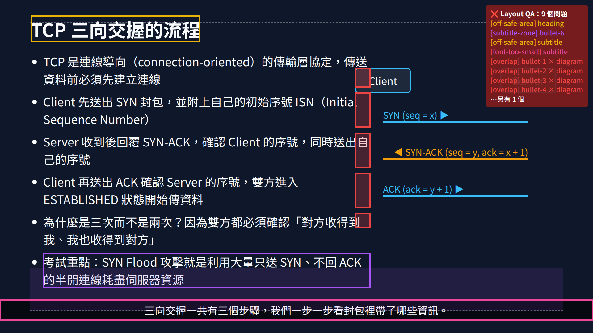
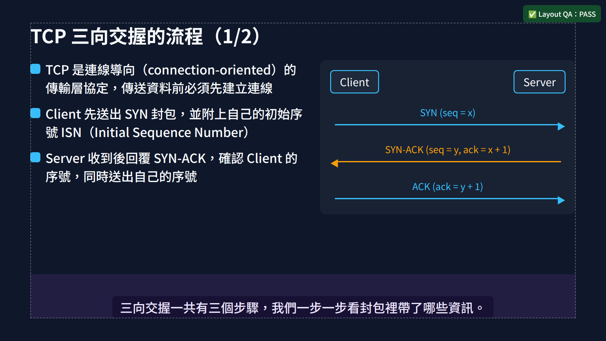
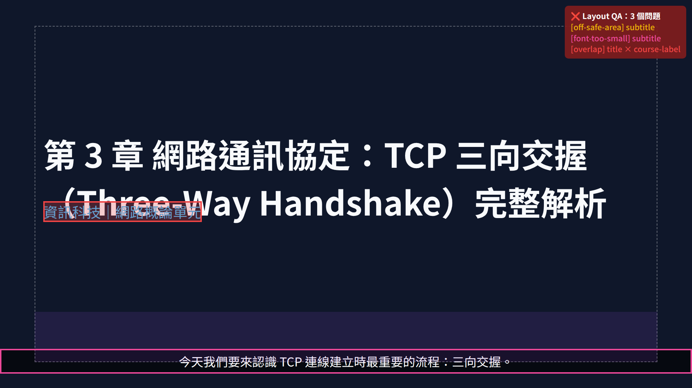
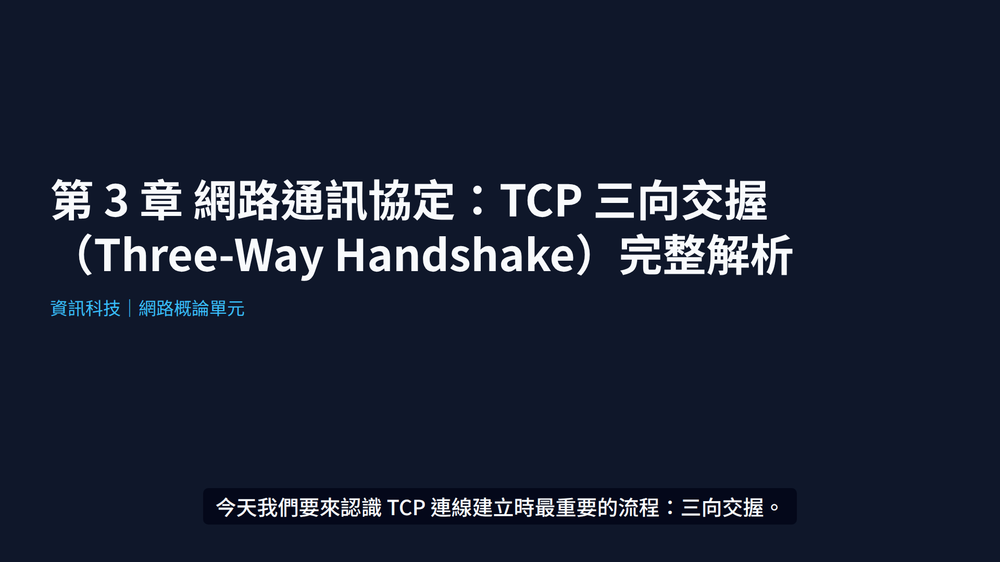
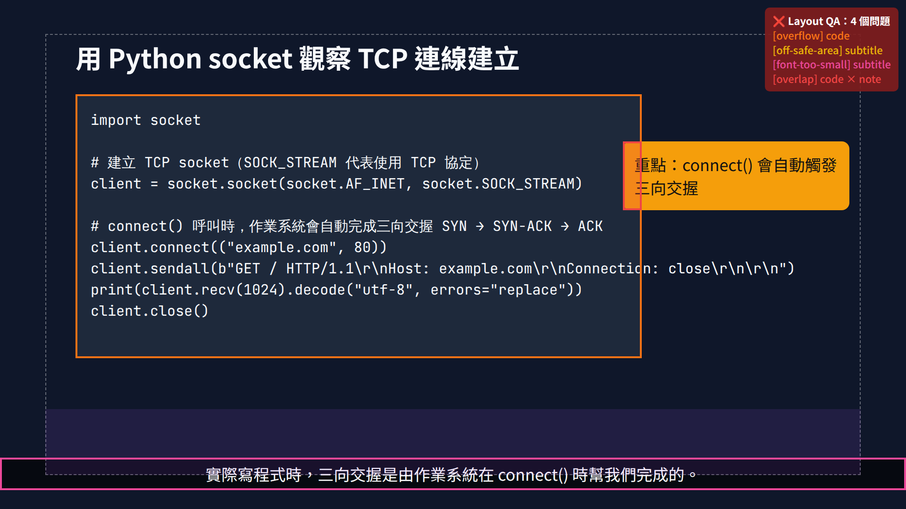
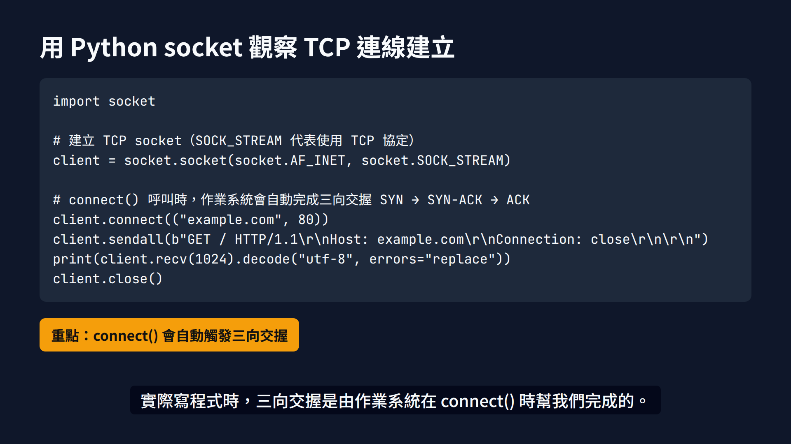

# 教學影片版面自動檢查：完整做法與 A/B 測試套件

這份套件解決 AI 製作教學影片時最常見的美工問題：**應該一行的文字變兩行、字大小不一、物件互相重疊、文字超出畫面、壓到字幕**。

它整合了兩份建議（Claude 與 ChatGPT）的共同結論，並且可以直接執行。同一份資訊科教材（TCP 三向交握）會產生兩個版本，讓你比較「沒用方法」和「用了方法」的差別：

| 版本 | 作法 |
|---|---|
| **Baseline** | 模擬 AI 直接產生的寫法：`position:absolute` 寫死座標、寫死字級、條列全部塞進同一幕 |
| **Guarded** | 這套方法：規則寫死 → 版型元件 → 文字尺寸控制 → 自動拆頁 → DOM 自動檢查 →（可選）AI 看圖審查 |

## 實測結果（這個 repo 裡實際跑出來的）

| 版本 | 場景數 | 問題總數 | 重疊 | 超框 | 超出安全區 | 壓到字幕區 | 字太小 |
|---|---|---|---|---|---|---|---|
| Baseline | 3 | **16** | 7 | 1 | 4 | 1 | 3 |
| Guarded | 4 | **0** | 0 | 0 | 0 | 0 | 0 |

Guarded 多出一幕，是因為 6 個條列放不下，被自動拆成「1/2」和「2/2」兩頁，而不是把字縮小。

| Baseline（紅框 = 檢查器抓到的問題） | Guarded |
|---|---|
|  |  |
|  |  |
|  |  |

成品影片：[`docs/samples/Baseline.mp4`](docs/samples/Baseline.mp4)、[`docs/samples/Guarded.mp4`](docs/samples/Guarded.mp4)

---

## 一、整體路線（五層防線）

```
 ① 規則寫死         rules.ts：安全區、字幕區、各角色字級上下限、行數上限
       ↓
 ② 版型元件         primitives.tsx：Stage / Split / BulletList / CodeBlock…
                    AI 只能「選元件、填內容」，不能自己寫 x/y 座標
       ↓
 ③ 文字尺寸控制     fitText 算標題字級；放不下 → 改兩行 → 再不行就警告縮短文案
                    條列依預估高度自動拆頁；程式碼依最長行與可用高度算字級
       ↓
 ④ DOM 自動檢查     LayoutQA：每幕在版面穩定那一格量測所有元素
                    重疊、超框、超出安全區、壓到字幕區、字太小、非預期換行、間距過小
       ↓
 ⑤ AI 看圖審查      review.ts：截圖 + ④的結果交給 Claude
                    檢查程式量不到的：視覺階層、擁擠、留白失衡、教學重點是否一眼可見
       ↓
   不合格 → 依報告修改（換版型 / 拆場景 / 縮短文案）→ 重新渲染 → 回到 ④
   PASS  → 輸出影片
```

**核心原則：不要一直縮字來救版面。** 字級有下限，到了下限還放不下，就代表這一幕內容太多，應該拆場景或改文案。

### 每一層對應的檔案

| 層 | 檔案 | 你要改的地方 |
|---|---|---|
| ① 規則 | `src/layout/rules.ts` | 安全區、字級、顏色、每頁條列數，改成你頻道的風格 |
| ② 元件 | `src/layout/primitives.tsx` | 增加你常用的版型（例如左右比較、流程圖、表格） |
| ③ 尺寸控制 | `FitTitle`、`CodeBlock`、`timeline.ts` 的 `paginateBullets` | 通常不用改 |
| ④ DOM 檢查 | `src/qa/LayoutQA.tsx`、`scripts/qa.ts` | 通常不用改；新元素記得加 `data-qa` |
| ⑤ AI 審查 | `scripts/review.ts` | 評分表與系統提示可依教學需求調整 |
| 給 AI 的規則 | `LAYOUT_RULES.md` | 貼進你產生影片時用的提示詞 |

---

## 二、安裝與執行

需要 Node.js 18 以上。

```bash
cd video-layout-qa
npm install
npm run fonts        # 下載 Noto Sans TC 與 JetBrains Mono 到 public/fonts（只需一次）

npm run studio       # 開 Remotion Studio，可以即時預覽 Baseline / Guarded（畫面上會顯示 QA 紅框）
npm run qa           # 第一層檢查 → out/qa/report.md（含每幕截圖）
npm run render       # 輸出兩支 MP4 → out/video/
npm run review       # 第二層 AI 審查（需要 ANTHROPIC_API_KEY）→ out/review/report.md
```

其他參數：
- `npm run qa -- --only Guarded --strict`：只檢查 Guarded，有問題就以錯誤碼結束，可以放進 CI 或讓 AI 自我檢查。
- `npm run render -- --overlay`：輸出含紅框的版本，可以當教學示範。
- 第一次渲染時 Remotion 會自動下載瀏覽器。如果你的環境不能下載，可以設定 `BROWSER_EXECUTABLE=/path/to/chrome`。

---

## 三、自己做 A/B 測試的步驟

1. **跑一次內建範例**：`npm run qa && npm run render`，看 `out/qa/report.md` 和兩支 MP4，熟悉報告格式。
2. **換成你的教材**：改 `src/content.ts`（標題、條列、程式碼、字幕）。兩個版本會同時更新，所以比較是公平的。
3. **測試你原本的 AI 流程**：把你平常請 AI 產生的場景程式碼放進 `src/scenes/Baseline.tsx`，替換掉目前的模擬版本。每個文字元素都加上 `data-qa="名稱"` 和 `data-qa-role="title|heading|body|label|code|subtitle|figure"`，讓檢查器量得到。
4. **用這套方法產生同樣內容**：請 AI 依照 `LAYOUT_RULES.md` 只用 `primitives.tsx` 的元件改寫 `src/scenes/Guarded.tsx`，並要求它跑 `npm run qa -- --only Guarded --strict`，直到通過為止。
5. **比較**：
   - 客觀指標：`out/qa/report.md` 總表的問題數量。
   - 主觀指標：`out/review/report.md` 的五項分數（階層、擁擠、對齊、可讀、教學重點）。
   - 實際觀感：並排播放兩支 MP4，最好也在手機上看一次。
6. **記錄修正輪數**：從 AI 產生到通過檢查，總共修了幾輪。這個數字可以衡量方法帶來的穩定度。

建議用 2 到 3 個不同類型的單元測試，例如概念講解、程式碼教學和流程圖，因為不同版型容易出現的問題不一樣。

---

## 四、套用到你自己的專案

**如果你本來就用 Remotion**：直接複製 `src/layout/`、`src/qa/` 和 `scripts/qa.ts`，把場景改用版型元件，再用 `<LayoutQA>` 包住每一幕即可。

**如果你用 Manim**：概念完全相同，只是換成 Manim 的作法：
- ①② 用 `VGroup().arrange()`、`next_to()`，不要寫死座標；字級寫成常數。
- ③ 用 `scale_to_fit_width()` 時加上最小字級判斷，低於下限就拆場景。
- ④ 在 `construct()` 結尾檢查每個 mobject 的 bounding box（`get_left()`、`get_right()`、`get_top()`、`get_bottom()`）是否兩兩相交、是否超出 `config.frame_width/height` 扣掉安全邊距。
- ⑤ 用 `manim -s` 輸出最後一格截圖，再交給 `review.ts` 的同一套審查流程。

**如果你用 PowerPoint 或其他 AI 影片平台**：只能做第 ⑤ 層。把每一幕截圖交給 `review.ts` 審查，或用 OCR 工具抓文字框位置來檢查重疊。

---

## 五、參考的開源專案與研究

| 專案 | 這套方法借用了什麼 |
|---|---|
| [Remotion](https://github.com/remotion-dev/remotion) + `@remotion/layout-utils` | 影片框架、`fitText()` 文字尺寸計算 |
| [remotion-dev/skills](https://github.com/remotion-dev/skills) | 官方 AI 規則：不要絕對定位、預留換行空間、內容多就拆場景 |
| ReDeck（[arXiv 2609.00194](https://arxiv.org/abs/2609.00194)） | 渲染後量測重疊、超框、裁切，每次修改後都重新檢查的修正迴圈 |
| [Code2Video](https://github.com/showlab/Code2Video) | 用固定網格或錨點限制物件位置，加上 AI 審查員看圖修正 |
| [SlideMason](https://github.com/Airoxog/slidemason) | 限制 AI 只能使用設計好的版型元件 |

## 已知限制

- DOM 檢查只看得到有標 `data-qa` 的元素。SVG 裡的文字、背景圖這類元素要自己加標記，否則不會被檢查。
- 檢查器只檢查每一幕「版面穩定」的那一格（第 45 格）。進場動畫途中的暫時重疊不會被抓到。如果需要，可以在 `timeline.ts` 的 `checkpoints` 增加檢查點。
- `review.ts` 要呼叫 Claude API，會產生費用。每一幕送一張圖，估計每幕約 0.05 到 0.1 美元，實際金額以 API 帳單為準。
